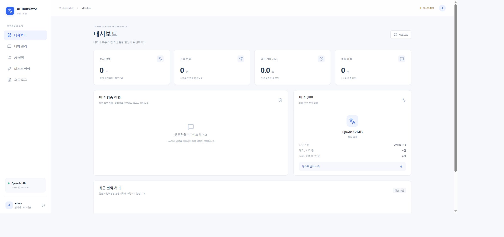

# AI-Translator · Phase 3

한국어 ↔ 선택 언어(태국어·베트남어·영어·일본어) LINE 1:1·그룹 자동 번역 백엔드. Java 21 / Spring Boot 3.5 / Maven / MyBatis / MariaDB.
관리 화면은 **React + TypeScript + Vite**로 구현했다. `/admin/`에서 관리자 로그인 후 사용한다.

Windows 설치 경로는 `C:\ai\project\AI-Translator`를 기준으로 설명한다. 처음 LINE 계정을 준비한다면 아래 [LINE 계정 생성부터 봇 연결까지](#line-계정-생성부터-봇-연결까지)를 순서대로 진행한다.

## 인증정보 없이 실행 (Mock)

필수: **JDK 21** (`java -version`, `javac -version` 모두 21), Maven 3.9+, Node.js/npm(관리자 UI 빌드), Python 3(웹훅 전송 스크립트 사용 시).

```powershell
cd C:\ai\project\AI-Translator\frontend
npm ci
npm run build
cd ..\backend
mvn clean verify
mvn spring-boot:run
```

빌드된 JAR가 포함된 배포 ZIP에서는 프로젝트 루트에서 `java -jar backend/target/ai-translator-0.1.0.jar`로도 바로 실행할 수 있다 (Java 21 필요).

기본 profile은 `mock`이다. 내장 H2 메모리 DB라 MariaDB/Redis/LINE/AI 키가 필요 없다. 서버는 기본 `127.0.0.1:8090`에 바인딩한다.

- 상태 확인: http://localhost:8090/actuator/health
- `/`에는 화면이 없으며 403 응답이 정상이다.
- Mock은 아래 **고정 문장만** 번역한다. 일반 문장 번역 능력은 없으며 `[MOCK]` 표식을 붙인다.

| 입력 | Mock 결과 |
| --- | --- |
| 안녕하세요 | สวัสดีค่ะ |
| สวัสดีค่ะ | 안녕하세요 |
| 내일 아침 9시에 출발할게. | พรุ่งนี้ฉันจะออกเดินทางตอนเก้าโมงเช้า |
| พรุ่งนี้เจอกันตอนสิบโมงนะ | 내일 10시에 만나자. |

다른 터미널에서 프로젝트 루트로 이동한 후:

```powershell
python scripts/mock-webhook.py
python scripts/mock-webhook.py --text "พรุ่งนี้เจอกันตอนสิบโมงนะ"
```

각 명령은 같은 이벤트를 두 번 보내며 HTTP 200을 두 번 받는다. 백엔드 로그에는 `outcome=SENT`가 한 번만 남아야 한다. Mock 회신은 내부 메모리 sink로 전달되며 실제 LINE으로 전송하지 않는다. 자동 통합 테스트가 정확한 회신 문구까지 검증한다. 종료는 Ctrl+C. Mock DB는 재시작 시 초기화된다.

## 집 PC의 Qwen 사용 — 현재 진행 방식

Windows 10 + 기존 OpenAI 호환 `Qwen3-14B` API를 지원한다. 외부 유료 AI 대신 `LocalQwenProvider`를 선택한다. 로컬 실행은 별도 설정 파일을 만든 뒤 `java -jar`로 실행한다. Docker 실행은 [Windows Qwen 실행 가이드](docs/windows-qwen.md)와 `.env.qwen.example`을 참고한다. LINE Webhook URL은 Qwen `/v1` 주소와 별도다.

### 로컬 설정 파일 위치

프로젝트를 `C:\ai\project\AI-Translator`에 설치한 경우:

| 파일 | 역할 |
| --- | --- |
| `C:\ai\project\AI-Translator\config\application.properties` | 실제 LINE Secret·Token, Qwen 주소·모델, 서버 포트, DB 경로, 기본 언어. Git에서 제외된다. |
| `C:\ai\project\AI-Translator\config\application.properties.example` | 값이 비어 있는 설정 예제. GitHub에 포함된다. |

실제 설정 파일은 일반 텍스트로 직접 편집한다. 키·토큰은 이 파일에만 넣고 GitHub나 채팅에 공유하지 않는다. 이전 `.env.line.credentials.xml` 파일은 더 이상 읽지 않는다. 실행 스크립트는 선택 사항이며 별도 입력 없이 Java 실행을 돕는 용도로만 사용한다.

### 번역 언어 선택

`config/application.properties`의 `app.translation.partner-language=TH` 값을 `TH`(태국어), `VI`(베트남어), `EN`(영어), `JA`(일본어) 중 하나로 설정한다. 기본값은 `TH`이며, 대화에서 별도로 변경하지 않은 경우 이 설정을 따른다. 선택한 언어와 한국어 사이에서만 번역한다. 임시로 기본 언어를 바꾸려면 실행 인수를 사용한다.

```powershell
java -jar backend/target/ai-translator-0.1.0.jar --app.translation.partner-language=EN
```

기본 언어 변경은 재시작 후 적용되며 키·토큰은 그대로 재사용한다. Docker에서는 환경변수 `TRANSLATION_PARTNER_LANGUAGE`로 지정한다. 각 대화에 저장된 언어 설정은 서버의 기본 언어보다 우선한다.

### LINE 1:1 대화에서 번호로 번역 언어 선택

봇과의 **1:1 대화**에서 `/설정`을 보내면 현재 언어와 다음 메뉴를 보여준다. 각 사용자의 설정은 다른 사용자·그룹과 분리된다. 기존 그룹에서도 같은 명령어를 참여자 누구나 사용할 수 있다.

| 대화에 보내는 메시지 | 동작 |
| --- | --- |
| `/언어 1` | 한국어 ↔ 태국어 |
| `/언어 2` | 한국어 ↔ 베트남어 |
| `/언어 3` | 한국어 ↔ 영어 |
| `/언어 4` | 한국어 ↔ 일본어 |
| `/설정` | 현재 번역 언어와 1~4번 메뉴 확인 |
| `/기본언어 한국어` | 선택한 번역 쌍 이외의 메시지를 한국어로 번역 |
| `/번역 켜기`, `/번역 끄기` | 해당 대화의 번역 ON/OFF |
| `/검증 전체`, `/검증 경고`, `/검증 숨김` | 역번역·검증 정보 표시 방식 |
| `/문맥 0`, `/문맥 5`, `/문맥 10` | 최근 대화 문맥 사용 개수. 0이면 저장·사용 OFF |
| `/상태`, `/도움말` | 현재 설정 / 전체 명령어 안내 |

`/언어 1`만 보내도 즉시 저장되고 봇이 변경 결과를 답장한다. 서버 재시작 없이 이후 해당 대화의 메시지부터 새 언어로 번역한다. `/언어 태국어`, `/언어 베트남어`, `/언어 영어`, `/언어 일본어`와 언어 코드 `TH`, `VI`, `EN`, `JA`도 지원한다. 잘못된 번호·언어를 입력하면 현재 설정과 메뉴를 안내하고 기존 설정을 유지한다. 명령어 자체는 AI로 번역하지 않는다.

### 선택 언어 외 메시지의 기본 번역 언어

`/기본언어 한국어`, `/기본언어 태국어`, `/기본언어 베트남어`, `/기본언어 영어`, `/기본언어 일본어`로 해당 대화의 기본 번역 언어를 설정한다. 언어 코드 `KO`, `TH`, `VI`, `EN`, `JA`도 지원한다. 예를 들어 `/언어 1`과 `/기본언어 한국어`를 설정하면 한국어↔태국어는 그대로 양방향 번역하고, 영어·일본어 등 그 밖의 입력은 한국어로 번역한다. `/기본언어 태국어`로 바꾸면 그 밖의 입력을 태국어로 번역한다.

`/설정`에서 현재 기본언어를 확인한다. 기본언어를 한 번도 설정하지 않은 대화는 기존처럼 선택 쌍 밖의 메시지를 건너뛴다. 설정은 `chat_default_languages` 테이블에 대화별로 저장하며 기존 번역 쌍을 변경하지 않는다. 재시작 후에도 유지된다. 이미 기본언어로 감지된 쌍 밖의 입력은 중복 번역하지 않는다. 언어를 확정할 수 없는 문자 입력은 AI에 원문 언어 감지를 맡겨 기본언어로 번역한다. 숫자·이모지만 있는 메시지는 계속 건너뛴다.

설정은 기존 DB의 `chat_group_languages` 테이블에 저장한다. 기존 `group_id` 열을 대화 식별자로 사용하며 1:1은 LINE userId, 그룹은 groupId로 구분한다. 파일형 H2 또는 MariaDB를 사용하면 서버 재시작 후에도 유지된다. 메모리 DB를 쓰는 Mock에서는 재시작 시 초기화된다. 기존 그룹 설정과 데이터는 유지한다. 이미 처리된 명령어의 재전송과 오래된 명령어로 설정이 다시 바뀌지 않도록 처리한다.

영어는 라틴 문자, 일본어는 히라가나·가타카나를 기준으로 감지한다. 베트남어 모드에서는 성조가 없는 문장도 처리하도록 라틴 문자 메시지를 베트남어로 해석하므로 영어 문장도 베트남어 입력으로 처리될 수 있다. 라틴 문자만으로 언어를 완벽히 구분하지는 못한다. 한자만 있는 문장·다른 문자권·혼합 한태일 문장은 기본언어가 설정되면 AI 자동 감지로 번역하고, 미설정이면 건너뛴다. 숫자·이모지만 있는 메시지는 건너뛴다. Mock에서는 `안녕하세요`, `สวัสดีค่ะ`, `Xin chào`, `Hello`, `こんにちは`, `你好` 인사 예문을 지원한다.

### 최초 저장 및 키·토큰 변경

새로 설치하는 경우 LINE Developers에서 해당 채널의 **Basic settings → Channel secret**과 **Messaging API → Channel access token (long-lived)**을 준비한다. PowerShell에서 예제를 한 번만 복사한다. 기존 설정이 있으면 덮어쓰지 않는다.

```powershell
cd C:\ai\project\AI-Translator
if (!(Test-Path config/application.properties)) {
    Copy-Item config/application.properties.example config/application.properties
}
notepad config/application.properties
```

`app.line.secret=` 오른쪽에 Channel Secret을, `app.line.token=` 오른쪽에 Access Token을 따옴표 없이 넣고 저장한다. `spring.profiles.active=qwen`이 실제 번역 모드를 선택한다. 키·토큰을 바꿀 때도 이 파일만 편집한다. 환경변수나 매번 입력하는 절차는 필요 없다.

### 설정 적용 및 서버 실행

실행 중인 번역 서버가 있으면 해당 창에서 **Ctrl+C**로 종료한 뒤 실행한다.

```powershell
cd C:\ai\project\AI-Translator
java -jar backend/target/ai-translator-0.1.0.jar
```

Spring Boot가 프로젝트 루트의 `config/application.properties`를 자동으로 읽고 `qwen` 프로필로 시작한다. 반드시 프로젝트 루트에서 실행한다. 기본 연결은 번역 서버 `127.0.0.1:8090`, Qwen `http://127.0.0.1:8082/v1`, 모델 `Qwen3-14B`이며, DB는 `backend/data/translator` 파일에 저장한다. Push 발송은 꺼져 있다. 이 파일이 없으면 기본 Mock 모드로 시작하므로 로그의 활성 프로필이 `qwen`인지 확인한다.

키·토큰 또는 연결 설정을 변경한 후에는 서버를 재시작해야 적용된다. 포트를 바꾸면 Caddy의 번역 서버 연결 포트도 함께 맞춘다.

실행 후 상태 확인: http://localhost:8090/actuator/health → `{"status":"UP"}`. `/`는 웹 화면이 없어 403을 반환한다. 현재 PC의 Caddy 설정에서는 공개 상태 확인 주소가 `https://dsss.mooo.com/actuator/health`, LINE Webhook URL이 `https://dsss.mooo.com/webhooks/line`이다. Caddy 설정은 프로젝트 외부의 `C:\ai\caddy\Caddyfile`에서 관리한다.

LINE에서 **Use webhook**을 켜고 봇을 친구로 추가한 뒤 1:1 대화에서 `/설정`을 보낸다. 그룹에서도 사용하려면 **Allow bot to join group chats**를 켜고 봇을 초대한다. 한국어·선택 언어 텍스트를 번역한다. LINE 기본 안내 문구가 번역과 함께 오면 Official Account Manager의 **설정 → 응답 설정 → 자동응답 메시지**를 끄고 Webhook은 켜 둔다.

## Phase 2 — 역번역 검증과 대화 문맥

번역 후 역번역과 의미 비교를 수행하고 PASS / WARNING / FAIL, 경고 코드, 역번역, 처리 시간과 모델 정보를 반환한다. 숫자·시간·금액·이름·장소·긍정/부정·질문/명령·의미 누락·정보 추가를 검사한다. 숫자는 모델 판정 외에 코드로도 비교한다. FAIL이면 시간 예산 안에서 최대 한 번 재번역·재검증하며 명백한 왜곡이 해소되지 않으면 번역문 대신 확인 안내를 보낸다.

기본적으로 번역문만 표시한다. LINE에서 `/검증 전체`를 보내면 역번역과 판정도 볼 수 있다. `/검증 경고`는 경고가 있을 때 표시하고 `/검증 숨김`은 정상 검증 정보를 숨긴다. 숨김도 검증 실행은 계속하며 위험 차단·지속 FAIL·검증 불가 안내는 유지한다. 모델 오류나 시간 초과를 PASS로 처리하지 않는다.

채팅에는 역번역문 앞에 상태 `✅`(통과), `⚠️`(주의), `❌`(실패·차단)를 바로 붙인다. 예: `✅ 내일 만나요.` 별도 역번역 아이콘이나 `검증: PASS`, `역번역:` 같은 접두어는 붙이지 않는다. 주의·실패 이유는 다음 줄에 `(의미누락, 정보추가)`처럼 괄호로 묶고, 검증 불가 안내는 필요한 경우 유지한다.

문맥은 대화별 최근 원문 10개, 기본 600초 만료의 RAM 저장소를 사용한다. 모델에 보내는 문맥은 4,000자 이하로 제한하고 봇 번역문·명령어는 저장하지 않는다. `/문맥 0`으로 OFF 및 기존 문맥 삭제, `/문맥 5` 또는 `/문맥 10`으로 개수를 선택한다. `/번역 끄기`는 해당 대화의 번역과 문맥 축적을 중단하며 `/번역 켜기`로 복구한다. 설정은 DB에 남지만 문맥 원문은 서버 재시작 시 사라진다. 1:1에서는 본인, 그룹에서는 누구나 해당 대화의 명령어를 사용할 수 있다.

`config/application.properties`의 선택 설정:

```properties
app.verification.enabled=true
app.verification.budget-ms=30000
app.context.max-messages=10
app.context.ttl-seconds=600
```

기존 설정 파일에 위 값이 없어도 기본값으로 동작한다. 검증용 서버·모델·키를 별도로 지정할 수도 있다. 기본은 현재 Qwen을 별도 요청으로 재사용하므로 독립 모델 검증과 같지는 않다. PASS는 자동 검사에서 문제를 못 찾았다는 뜻이며 사람 검수 없이 정확성을 보증하지 않는다. 기본 AI 호출이 1회에서 3회로 늘어나므로 기존 처리량 추정은 재평가해야 한다. 자세한 처리·실패 정책, 문맥 보관과 실제 Qwen 평가 명령은 [Phase 2 품질 가이드](docs/phase2-quality.md)를 참고한다.

## Railway 클라우드 배포 — 선택 사항

[Railway 배포 가이드](docs/railway-deploy.md)에 MariaDB 영속 볼륨, 비밀 환경변수, 공개 HTTPS와 LINE 연결 절차를 정리했다. 계정 연결과 실제 배포는 별도 진행해야 한다.

## LINE 계정 생성부터 봇 연결까지

2026-10-16 기준 공식 문서와 현재 Windows/Qwen 구성을 기준으로 정리했다. 화면 언어에 따라 메뉴명이 다를 수 있으므로 영문 이름을 함께 표시한다.

### 1. 관리 사이트와 현재 채널 바로가기

| 사이트 | 역할 |
| --- | --- |
| [LINE Business ID](https://account.line.biz/) | 관리자로 로그인하는 계정. 개인 LINE 계정 또는 이메일로 등록 |
| [LINE Official Account 생성](https://entry.line.biz/) | 사용자가 친구로 추가할 봇의 공식 계정 생성 |
| [LINE Official Account Manager](https://manager.line.biz/) | 공식 계정의 프로필, Messaging API 활성화, 자동응답·인사말 관리 |
| [LINE Developers Console](https://developers.line.biz/console/) | Provider와 채널, Secret·Token, Webhook 설정 |
| [현재 번역 봇 채널 / LINE 비즈니스 바로가기](https://developers.line.biz/console/channel/2012046604) | 사용자가 제공한 채널 ID `2012046604`의 설정 페이지. 해당 계정 로그인과 관리 권한 필요 |

Business ID는 관리자 로그인 계정, Official Account는 친구 목록에 보이는 봇, Provider는 채널을 관리하는 묶음, Messaging API 채널은 프로그램과 LINE을 연결하는 설정 단위다. 마지막 링크는 공개 소개 페이지가 아니므로 로그인 화면이나 권한 오류가 나오면 해당 채널을 관리하는 계정인지 확인한다.

### 2. Business ID와 Official Account 만들기

이미 현재 공식 계정과 채널을 사용 중이면 새로 만들지 말고 4번부터 확인한다.

1. [공식 계정 생성](https://entry.line.biz/)을 연다.
2. Business ID 로그인·등록 화면에서 개인 LINE 계정 또는 이메일 등록 방식을 선택한다.
3. 처음 등록한다면 화면의 인증 절차를 마친다.
4. 공식 계정 생성 양식에 봇 표시 이름, 이메일 등 필수 항목을 입력한다. 예: 계정명 `AI 번역봇`. 국가·지역과 업종 등은 실제 사용 환경에 맞춘다.
5. 입력 내용을 확인하고 계정을 생성한다.
6. [Official Account Manager](https://manager.line.biz/)에서 방금 만든 계정이 보이는지 확인하고 선택한다.

세부 생성 흐름: [LINE 공식 시작 가이드](https://developers.line.biz/en/docs/messaging-api/getting-started/).

### 3. Messaging API 활성화와 Provider 선택

1. Official Account Manager에서 해당 공식 계정 → **설정(Settings) → Messaging API**를 연다.
2. **Messaging API 사용(Use Messaging API / Enable Messaging API)**을 선택한다.
3. 개발자 등록 안내가 나오면 이름·이메일 등 필요한 정보를 등록한다.
4. 채널을 관리할 Provider를 선택하거나 새로 만든다. 개인 프로젝트라면 본인이 계속 관리할 Provider를 사용한다.
5. 연결 내용을 확인하고 활성화한다.
6. 같은 관리자 계정으로 Developers Console에 로그인하고 **Provider → Messaging API 채널**이 생성됐는지 확인한다.

Provider는 연결 후 변경·해제할 수 없으므로 기존 서비스와 연결할 계정인지 확인하고 선택한다. 현재 Messaging API 채널은 Developers Console의 새 채널 버튼에서 직접 만들지 않고 공식 계정의 Messaging API 활성화로 생성한다. [공식 생성 절차](https://developers.line.biz/en/docs/messaging-api/getting-started/).

### 4. Channel Secret과 Access Token 준비

Developers Console에서 해당 **Messaging API 채널**을 연다. 현재 봇은 [채널 2012046604](https://developers.line.biz/console/channel/2012046604) 바로가기를 사용할 수 있다.

| 값 | 확인 위치 | 프로젝트 설정 | 용도 |
| --- | --- | --- | --- |
| Channel secret | **Basic settings → Channel secret** | `app.line.secret` | 받은 Webhook이 LINE에서 보낸 요청인지 서명 검증 |
| Channel access token | **Messaging API → Channel access token (long-lived)** | `app.line.token` | 봇이 LINE API로 답장할 때 인증 |
| Channel ID | Basic settings | 키·토큰 칸에 넣지 않음 | 채널 식별 번호 |
| Basic ID (`@...`) | 공식 계정 정보 / Messaging API | 키·토큰 칸에 넣지 않음 | 친구 추가에 쓰는 계정 ID |

Secret을 복사하고, Access Token은 **Issue(발급)**를 눌러 준비한다. 기존 값이 있으면 해당 채널의 유효한 토큰인지 확인한다. 이 프로젝트의 현재 설정은 화면에서 발급하는 long-lived 토큰을 사용한다. LINE은 만료 시간을 지정하는 v2.1 등 다른 토큰 방식도 제공한다. [토큰과 봇 설정 공식 안내](https://developers.line.biz/en/docs/messaging-api/building-bot/).

두 값은 서로 다르다. LINE 로그인 비밀번호나 Channel ID를 대신 넣지 않는다. Secret·Token은 실제 설정 파일에만 저장하고 README, GitHub, 캡처에 포함하지 않는다. 재발급·변경했다면 서버 설정도 갱신하고 재시작한다.

### 5. 별도 설정 파일에 저장하고 서버 실행

프로젝트 루트의 PowerShell에서 실행한다. 기존 설정 파일은 보존한다.

```powershell
cd C:\ai\project\AI-Translator
if (!(Test-Path config/application.properties)) {
    Copy-Item config/application.properties.example config/application.properties
}
notepad config/application.properties
```

파일에서 다음 항목을 채우고 저장한다. 아래 두 입력 안내 문자열을 실제 값으로 교체하고 따옴표는 붙이지 않는다.

```properties
spring.profiles.active=qwen
server.port=8090
app.ai.provider=local-qwen
app.ai.base-url=http://127.0.0.1:8082/v1
app.ai.model=Qwen3-14B
app.line.secret=해당_채널의_Channel_Secret
app.line.token=해당_채널의_Channel_Access_Token
app.line.push-enabled=false
```

예제 파일에 포함된 DB 설정 등 나머지 항목도 유지한다. `config/application.properties`는 `.gitignore`에 등록돼 있고 예제만 GitHub에 올라간다. `git check-ignore config/application.properties`로 제외 여부를 확인할 수 있다. `.env`와 이전 암호화 XML은 이 실행 방식에서 읽지 않는다.

JAR가 없거나 소스가 변경됐다면 기존 서버를 종료한 뒤 먼저 빌드한다. 실행 중인 JAR를 다시 빌드하면 Windows 파일 잠금으로 실패할 수 있다.

```powershell
mvn -f backend/pom.xml clean verify
java -jar backend/target/ai-translator-0.1.0.jar
```

평소에는 `java -jar` 명령만 실행한다. 활성 프로필이 **qwen**, 포트가 **8090**인지 확인한다. 별도 PowerShell에서 `curl.exe http://localhost:8090/actuator/health`를 실행해 `{"status":"UP"}`을 확인한다. `/`는 차단되며 관리자 화면은 `/admin/`으로 접근한다.

### 6. Caddy로 공개 HTTPS 연결

현재 Windows 구성의 요청 흐름:

```text
LINE → https://dsss.mooo.com/webhooks/line
     → Caddy → http://127.0.0.1:8090/webhooks/line
```

현재 Caddy 설정 파일은 `C:\ai\caddy\Caddyfile`이며 Git 저장소 밖에 있다. 기존 `dsss.mooo.com` 블록에 다음 경로 처리가 들어 있다. 다른 서비스의 `/v1`과 기본 화면 처리도 있으므로 전체 설정을 아래 예제로 덮어쓰지 않는다.

```caddyfile
@translator path /webhooks/line /actuator/health /admin /admin/* /api/admin/*
handle @translator {
    reverse_proxy 127.0.0.1:8090
}
```

새 PC에 구성한다면 도메인이 해당 외부 주소를 가리키고 공유기·방화벽을 통해 Caddy의 HTTPS에 도달하도록 준비한다. Webhook에는 공인 인증서가 적용된 HTTPS 주소를 사용한다. Java의 8090은 로컬 HTTP이므로 `https://localhost:8090`으로 바꾸지 않는다. Qwen의 `/v1`은 추론 API이며 Webhook 주소가 아니다.

Caddy를 편집한 경우 먼저 검증하고 성공한 경우에만 다시 읽힌다.

```powershell
& C:\ai\caddy\caddy.exe validate --config C:\ai\caddy\Caddyfile --adapter caddyfile
if ($LASTEXITCODE -eq 0) {
    & C:\ai\caddy\caddy.exe reload --config C:\ai\caddy\Caddyfile --adapter caddyfile
}
curl.exe https://dsss.mooo.com/actuator/health
```

### 7. Webhook 저장·Verify·사용 설정

1. Developers Console → 해당 채널 → **Messaging API → Webhook settings**를 연다.
2. **Webhook URL → Edit**에서 `https://dsss.mooo.com/webhooks/line`을 입력하고 **Update / Save / 저장**을 누른다.
3. URL 근처의 **Verify(검증)**를 누르고 **Success**를 확인한다.
4. **Use webhook**을 **ON**으로 켠다.
5. 실패한 Webhook의 재전송을 사용하려면 **Webhook redelivery**도 켠다. 이 프로젝트는 동일 이벤트 ID의 중복 처리를 차단한다.

Official Account Manager에서 URL만 입력한 화면에는 Verify가 없을 수 있다. 이 경우 위 Developers Console의 Messaging API 탭에서 진행한다. Verify는 이벤트가 비어 있는 HTTP POST로 통신을 확인하며 서버는 200을 반환해야 한다. 브라우저에서 Webhook URL을 여는 GET 요청으로 대체할 수 없다. Success는 수신 연결 확인이므로 실제 번역·답장은 다음 단계에서 확인한다. [Verify 공식 안내](https://developers.line.biz/en/docs/messaging-api/verify-webhook-url/).

### 8. 기본 자동응답과 인사말 정리

1. [Official Account Manager](https://manager.line.biz/) → 해당 계정 → **설정 → 응답 설정(Response settings)**으로 이동한다.
2. **자동응답 메시지 / 응답 메시지(Auto-response messages / Auto-reply messages)**를 **OFF**로 바꾼다.
3. 처음 연결을 시험할 때는 **인사말(Greeting messages)**도 OFF로 두면 응답 구분이 쉽다. 필요하면 친구 추가 시 보여줄 안내만 나중에 설정한다.
4. **Webhook은 ON**으로 유지한다. 응답 시간 안팎 설정이 나뉜 화면이라면 두 경우의 자동응답을 확인한다.

“메시지를 보내주셔서 감사합니다. 이 계정은 메시지에 바로 회신할 수 있도록 설정되어 있지 않습니다”가 번역과 함께 나오면 이 기본 응답을 확인한다. 설정 변경은 LINE 측에서 적용하므로 Java 서버 재시작은 필요 없다. [자동응답 공식 안내](https://developers.line.biz/en/docs/messaging-api/building-bot/#settings-on-line-official-account-manager).

### 9. 친구 추가 후 1:1 대화 시험

1. Developers Console → **Messaging API**의 QR 코드를 휴대폰 LINE으로 읽어 봇을 친구로 추가한다.
2. 봇과의 **1:1 채팅**을 열고 `/설정`을 보낸다. 현재 번역 쌍·기본언어와 번호 메뉴가 나오는지 확인한다.
3. `/언어 1`을 보내 한국어↔태국어를 선택한다.
4. `안녕하세요`를 보내 태국어 답장을, `สวัสดีค่ะ`를 보내 한국어 답장을 확인한다.
5. `/언어 2`는 베트남어, `/언어 3`은 영어, `/언어 4`는 일본어다.
6. `/기본언어 한국어`를 설정하면 선택 쌍 밖의 입력을 한국어로 번역한다. 각 1:1 대화의 설정은 별도로 저장된다.

친구 추가만으로 설정 메뉴가 자동 발송되지는 않는다. 현재 구현은 `/설정` 메시지로 메뉴를 요청한다. 사진·음성·스티커는 번역하지 않는다.

### 10. 그룹에서 사용하기 (선택)

Developers Console → Messaging API → **Allow bot to join group chats**를 ON으로 바꾸고, 휴대폰 LINE 그룹의 초대 메뉴에서 친구로 추가한 봇을 초대한다. 그룹에서도 `/설정`, `/언어 1`, `/기본언어 한국어`로 시험한다. 그룹 참여자 누구나 그 그룹의 설정을 바꿀 수 있으며 개인 대화에는 영향을 주지 않는다. LINE 정책상 동시에 한 그룹에는 Official Account 하나만 참여할 수 있다. 1:1만 사용할 때는 그룹 참여 설정을 켤 필요 없다. [그룹 참여 공식 안내](https://developers.line.biz/en/docs/messaging-api/group-chats/).

### 11. 연결 오류 점검표

| 현상 | 확인할 내용 |
| --- | --- |
| 채널 링크에 접근 불가 / 채널이 안 보임 | 로그인 계정과 Provider·채널 관리 권한 확인. 현재 채널 대신 새 계정을 만들 필요가 있는지 먼저 구분 |
| `localhost:8090/`에서 403 | 웹 화면이 없는 백엔드. `/actuator/health`로 상태 확인 |
| Verify 401 / 403 | 해당 채널의 Secret인지, `qwen` 프로필인지, 프록시 경로·서명 전달이 맞는지 확인. 현재 보안 오류 처리상 서명 실패가 403으로 보일 수도 있음 |
| Verify 시간 초과 / 502 | Java 8090 기동, Caddy 실행, 도메인·외부 HTTPS 접근, 프록시 포트 확인 |
| Verify 성공인데 답장 없음 | Use webhook ON, 자동응답 OFF, 실제 Token, Qwen 8082 기동 확인. Verify만으로 Token 유효성이나 추론 성공을 검증하지는 않음 |
| `stage=delivery`, `outcome=UNKNOWN` | LINE 발송 단계 실패. Access Token이 해당 채널의 유효한 값인지 먼저 확인. 이 로그만으로 원인을 단정할 수 없고 이미 실패한 답장을 자동 재전송하지 않으므로 수정 후 새 메시지 전송 |
| 활성 프로필이 `mock` | 프로젝트 루트에서 실행했는지, `config/application.properties`와 `spring.profiles.active=qwen` 확인 |
| 포트 8090 사용 중 | 기존 서버 창에서 Ctrl+C로 종료 후 한 번만 실행 |
| 설정 파일을 바꿨는데 그대로 | Java를 재시작. LINE의 `/언어`, `/기본언어` 변경은 재시작 불필요 |
| 다른 PC의 localhost가 열리지 않음 | localhost는 접속 중인 기기 자신을 뜻함. 공개 HTTPS 상태 주소를 사용하거나 SSH 창에서 로컬 확인 |

### 12. 메시지 사용량과 완료 확인

현재 코드는 Reply 응답을 기본으로 쓰고 Push는 꺼 두었다. Reply는 LINE 요금제의 월 메시지 건수에 포함되지 않으며 Push 등은 포함된다. 요금·포함 건수는 국가·지역·플랜에 따라 다르므로 계정의 플랜을 확인한다. 이는 서버의 처리량·대기시간 제한과 별개다. [LINE 요금·집계 공식 안내](https://developers.line.biz/en/docs/messaging-api/pricing/).

최종 확인: 실제 설정 파일은 Git 제외, 서버는 qwen/8090, 로컬·HTTPS health는 UP, Verify는 Success, Use webhook은 ON, 자동응답은 OFF, 1:1 `/설정`·언어 변경·양방향 번역은 실제 답장으로 확인한다. 다음에 재설정할 때는 **같은 채널의 Secret·Token인지**부터 확인한다.

### Docker / MariaDB로 실행하는 경우

아래는 로컬 `config/application.properties` 방식과 별도의 배포 방법이다. Compose 설정은 `.env`를 사용하며 공개 진입 포트는 Nginx의 8080이다. 자세한 보충 안내는 [LINE 설정 가이드](docs/line-setup.md)를 참고한다.

Compose는 DB와 백엔드를 외부 포트로 열지 않고 Nginx만 localhost:8080에 공개한다. 외부 LINE 웹훅은 신뢰할 수 있는 HTTPS reverse proxy/터널을 통해 전달해야 한다. Nginx 설정은 로컬 HTTP용이며 공인 TLS 인증서를 제공하지 않는다.

```powershell
Copy-Item .env.example .env
# .env에 실제 값 입력
# Mock 서버가 8090에서 실행 중이면 Ctrl+C로 종료
docker compose up --build -d
docker compose logs -f backend
```

`.env`는 Compose에서 읽는다. **Maven/Java 실행은 .env를 자동으로 읽지 않는다.** 현재 Windows/Qwen 운영은 위 `config/application.properties` 방식을 사용한다. 아래는 별도 MariaDB와 외부 AI를 환경변수로 연결하는 대안 예시다 (이력에 남는 공유 터미널에 키를 입력하지 않는다).

```powershell
$env:SPRING_PROFILES_ACTIVE="live"
$env:DB_URL="jdbc:mariadb://localhost:3306/ai_translator"
$env:DB_USER="ai_translator"
# DB_PASSWORD, LINE_CHANNEL_SECRET, LINE_CHANNEL_ACCESS_TOKEN, AI_API_KEY는 OS 환경변수로 제공
cd backend
mvn spring-boot:run
```

MariaDB에는 `ai_translator` DB와 사용자 권한을 먼저 생성한다. 테이블은 시작 시 자동 생성하며 초기 SQL은 [database/001-schema.sql](database/001-schema.sql)에 있다. 외부 AI 기본값은 OpenAI 호환 Chat Completions API이고 `AI_BASE_URL`, `AI_MODEL`, `AI_TIMEOUT_SECONDS`로 변경한다. 실제 사용 계정에서 모델 사용 가능 여부를 확인한다.

## 구현 범위와 운영 제한

- raw HTTP body HMAC-SHA256 검증 후 수신, 1:1·그룹 text/active 이벤트만 처리.
- DB 접수 완료 후 200, 별도 worker에서 번역/회신. DB 오류는 5xx.
- 한국어/태국어/베트남어/영어/일본어를 설정된 언어 쌍으로 번역. 쌍 밖의 문자 입력은 대화의 기본언어가 있으면 해당 언어로 번역하며, 미설정이면 무시한다. 감지 한계는 위 안내 참고. 미지원 명령어·봇 자신은 무시.
- webhookEventId PK 중복 방지 (MariaDB에서 재시작 이후에도 7일 보존).
- 역번역·의미 검증·최대 1회 재번역, 대화별 문맥과 검증 표시 설정 지원. 관리자 웹은 별도 계정으로 로그인한다. 1:1은 각 사용자가, 그룹은 참여자 누구나 해당 대화의 설정을 변경 가능.
- LINE/AI 실패는 상태/안전한 로그로 기록. 불확실한 전달은 UNKNOWN이며 자동 재전송하지 않는다.
- 기본 Push 비활성. 비용을 이해한 후 `LINE_PUSH_ENABLED=true`일 때만 만료 Reply 대신 Push. Reply 실패 후 무조건 Push하지 않는다.
- DB 작업 원문/토큰은 완료 시 삭제. 문맥 ON이면 성공한 원문은 RAM에 제한된 개수·만료 시간으로 보관하며 `/문맥 0`으로 지운다. 원문 로그 없음. API 호출 횟수·실패·검증 상태·처리 시간은 내부 Micrometer 지표로 기록.
- 관리자 API는 세션 인증과 CSRF 검증을 적용한다. 미허용 경로는 차단한다.
- 단일 순차 worker MVP라 대규모 트래픽 SLA를 보장하지 않는다. 외부 API 응답 지연/실패와 정확도는 별도 실계정 검증이 필요하다.

[구조·오류 정책](docs/architecture.md) / [검증 기록](docs/validation.md).

## 테스트

```powershell
cd backend
mvn clean verify
```

서명 누락/위조/본문 변조, LINE Verify 이벤트, 한↔태 회신, 동시 중복 웹훅, 개인정보 제거, 다른 언어·봇·그룹 설정·오래된 토큰, AI 실패, 외부 HTTP Provider, LINE 요청 형식 및 호출 횟수를 자동 검증한다. 실제 LINE 채널이나 유료 AI 호출 없이 실행한다.

Phase 2 테스트에는 숫자 왜곡, FAIL 후 단 한 번 재번역, 위험 후보 차단, 검증 서버 오류·잘못된 JSON·역번역 언어 오류, 문맥 분리·중복·만료·OFF, 검증 표시와 번역 ON/OFF 명령도 포함한다. 실제 Qwen 소규모 평가는 별도 명령으로 실행하며 [품질 가이드](docs/phase2-quality.md)에 안내한다.

## Phase 3 — 관리자 운영 콘솔

새 JAR 적용 후 **https://dsss.mooo.com/admin/** 또는 `http://localhost:8090/admin/`에서 사용한다.

Git에서 제외된 `config/application.properties`에 계정을 설정한다. 비밀번호는 12자 이상이며, 비어 있으면 로그인이 비활성화된다. 로컬에 자동 생성된 값이 있으면 해당 값을 사용한다.

```properties
app.admin.username=admin
app.admin.password=직접_정한_충분히_긴_비밀번호
```

- 대시보드: 최근 7일 번역 건수, 전송 상태, 처리 시간, 검증 결과와 대기열. 새 버전부터 집계하며 원문·번역문은 통계에 저장하지 않는다.
- 대화 관리: 1:1·그룹의 번역 ON/OFF, 언어 쌍, 기본언어, 검증 표시, 문맥 개수와 초기화.
- AI 설정: 공급자·모델·API 주소·제한 시간을 DB에 저장한다. 재시작 후에도 파일의 해당 값보다 우선한다. 키와 검증 전용 모델은 설정 파일에서 관리한다. 처리 중에는 변경을 잠시 거부한다.
- 테스트 번역: 번역·역번역·의미 검증을 실행한다. LINE 전송이나 대화 문맥 저장, 운영 통계 집계는 하지 않는다.
- 오류 로그: HTTP 상태·단계·예외 종류만 최근 200건 RAM에 보관한다. 재시작하면 초기화되며 원문·토큰·응답 본문은 노출하지 않는다.

관리 세션은 30분이다. 여러 관리자 계정을 등록하는 화면은 현재 범위에 포함하지 않는다.

### 빌드와 적용

Node.js와 npm이 필요하다. 실행 중인 봇을 Ctrl+C로 종료한 후 프로젝트 루트에서 실행한다.

```powershell
.\scripts\build.ps1
java -jar backend\target\ai-translator-0.1.0.jar
```

이번에 실행 중인 서버를 유지한 채 준비한 산출물은 다음으로 적용한다.

```powershell
# 기존 서버를 Ctrl+C로 종료한 뒤
Copy-Item backend\target\language-build\target\ai-translator-0.1.0.jar backend\target\ai-translator-0.1.0.jar -Force
java -jar backend\target\ai-translator-0.1.0.jar
```

Docker는 `.env`의 `ADMIN_USERNAME`, `ADMIN_PASSWORD`를 사용하며 프런트엔드를 빌드에 포함한다. 개발 방법은 [frontend/README.md](frontend/README.md)를 참고한다.


